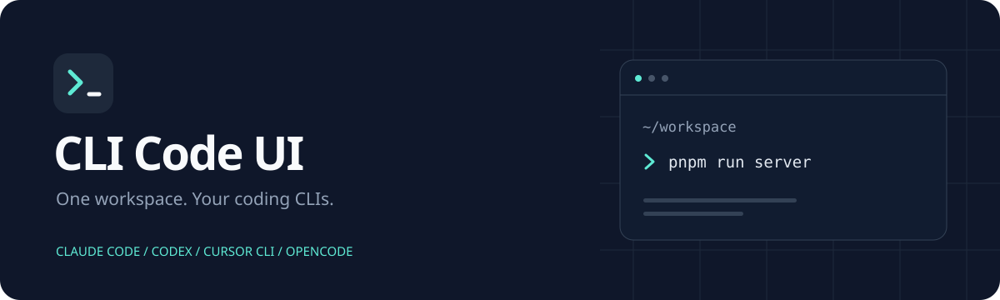

<p align="center"></p>
<h1 align="center">CLI Code UI</h1>
<p align="center">多种编程 CLI，一个 Web 工作台。</p>
<p align="center">Claude Code · Codex · Cursor CLI · OpenCode</p>
<p align="center">
  <a href="#快速开始">快速开始</a> ·
  <a href="#二次开发">二次开发</a> ·
  <a href="https://github.com/fwlee0625-prog/cliCodeUI/issues">问题反馈</a> ·
  <a href="LICENSE">AGPL-3.0-or-later</a>
</p>



CLI Code UI 是面向多种 AI 编程命令行工具的开源 Web 界面。通过浏览器管理项目与会话，在聊天、终端、文件和 Git 视图之间切换，也可以在手机上使用响应式界面。

**这是基于 [CloudCLI UI](https://github.com/siteboon/claudecodeui) 二次开发的独立修改版，由本仓库维护，不代表上游官方产品。** 当前修改包括产品品牌、Logo、中文说明及 pnpm 源码构建配置。品牌与文档修改日期：2026-10-28。

## 能做什么

- **多 CLI 工作台**：选择 Claude Code、Codex、Cursor CLI 或 OpenCode。
- **项目与历史会话**：查看项目、查找会话并继续已有对话。
- **聊天与终端**：通过图形界面交互，也保留命令行入口。
- **文件与 Git**：浏览和编辑文件、查看差异、管理项目版本。
- **MCP 与扩展**：配置对应供应商支持的 MCP 服务，使用上游兼容插件。
- **响应式界面**：适配桌面和移动浏览器，支持安装为 PWA。

各供应商的认证方式、模型和功能支持不同，以界面实际提供的选项为准。本项目提供操作界面，不提供 AI 订阅或模型额度。

## 快速开始

### 环境要求

- Node.js **22+**（`.nvmrc` 指定 v22；本地也已使用 v24 验证构建）。
- pnpm **11.25.0**，版本记录在 `package.json` 的 `packageManager` 中。
- Git，以及准备使用的编程 CLI 和对应账号认证。

### 下载、安装和构建

```bash
git clone https://github.com/fwlee0625-prog/cliCodeUI.git
cd cliCodeUI
pnpm install --frozen-lockfile
cp .env.example .env
pnpm build
```

原生依赖脚本的允许列表在 `pnpm-workspace.yaml`。当前网页构建不下载 Electron 桌面运行环境。

### 启动

```bash
pnpm run server
```

默认访问 **[http://localhost:3009](http://localhost:3009)**。首次打开时创建本地账号，这个账号与各 CLI 的供应商账号分开管理。

如果使用本地项目管理平台，将项目目录指向本仓库，启动命令设为 `pnpm run server`；启停和重启都通过管理平台操作。

### 常用配置

编辑 `.env`：

```dotenv
HOST=127.0.0.1
SERVER_PORT=3009
# 可选：Claude Code 不在 PATH 中时指定完整路径
# CLAUDE_CLI_PATH=/absolute/path/to/claude
```

| 配置项 | 用途 |
| --- | --- |
| `HOST` | 监听地址，示例默认仅本机访问 |
| `SERVER_PORT` | 页面、API 和 WebSocket 共用端口 |
| `CLAUDE_CLI_PATH` | 自定义 Claude Code 可执行文件位置 |
| `DATABASE_PATH` | 可选的账号数据库位置，默认 `~/.cloudcli/auth.db` |

为兼容已有安装，底层数据目录仍沿用上游名称。现有 Claude 会话和配置仍在 `~/.claude`，改名不会搬移或清除它们。

## 二次开发

```bash
# 前后端开发模式，前端默认 http://localhost:5173
pnpm dev

# 生产构建
pnpm build

# 测试、类型检查和代码检查
pnpm test:client
pnpm typecheck
pnpm lint
```

| 目录 | 内容 |
| --- | --- |
| `src/modules/` | 聊天、侧边栏、设置与文件编辑等界面模块 |
| `src/shared/` | 共享 UI、类型、工具及品牌常量 |
| `server/` | API、WebSocket 和 CLI 集成 |
| `public/` | Logo、浏览器图标及 PWA 资源 |
| `dist/` / `dist-server/` | 前端 / 后端构建产物，不提交到 Git |

修改页面后运行 `pnpm build`，再通过管理平台重启服务。前后端规范见 [AGENTS.md](AGENTS.md)。

### 品牌资源

Logo 使用深蓝终端窗口、薄荷绿提示符和白色光标，表达连接多种编程 CLI 的定位。

- Logo 源文件：[`src/shared/assets/brand-logo.svg`](src/shared/assets/brand-logo.svg)
- README 横幅：[`public/brand-banner.svg`](public/brand-banner.svg)
- 产品名称及仓库链接：[`src/shared/constants.ts`](src/shared/constants.ts)

修改 Logo 后生成网页、通知和 PWA 图标：

```bash
pnpm brand:assets
pnpm build
```

### 同步上游

自己的仓库使用 `origin`，原项目使用 `upstream`：

```bash
# 只需添加一次
git remote add upstream https://github.com/siteboon/claudecodeui.git

git fetch upstream
git merge upstream/main
pnpm install
pnpm build
```

同步前先提交本地改动。合并后检查依赖和锁文件，继续使用 pnpm 维护本仓库。

## 来源与许可

本项目基于 **CloudCLI UI (https://github.com/siteboon/claudecodeui)** 二次开发。

上游版权：Copyright 2025–2026 Siteboon AI B.V. and contributors。

保留 [LICENSE](LICENSE) 与 [NOTICE](NOTICE)，适用 **AGPL-3.0-or-later** 及 LICENSE 中列明的附加条款。分发或通过网络提供修改版本时，需按许可证向相应用户提供完整对应源码，并保留来源、版权和修改说明。

CLI Code UI 是独立修改版，不代表 Siteboon、CloudCLI、Anthropic、OpenAI、Cursor 或 OpenCode 官方产品；供应商名称用于说明集成对象。
